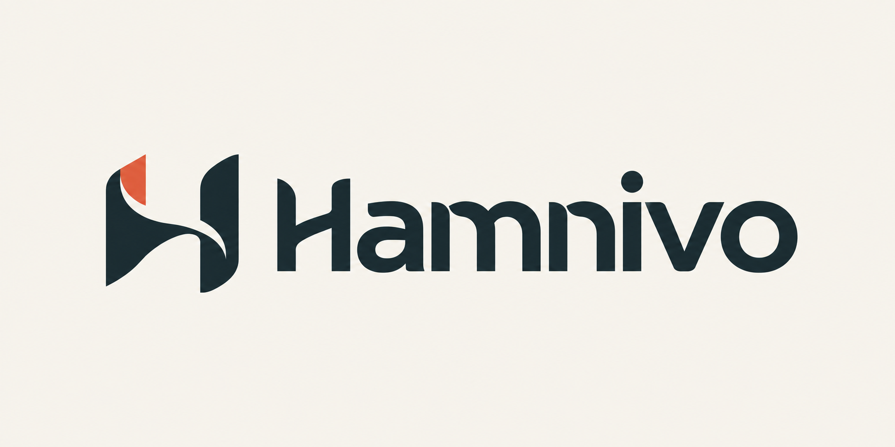

<p align="center">
  
</p>

<p align="center"><strong>Conversations, people and agents in one place.</strong></p>

Hamnivo is an embeddable, API-first conversation platform. Customers, human staff and scoped AI
specialists work in the same conversation: AI answers from cited knowledge, hands off to a person
on request, proposes actions that need explicit approval, and records what actually happened.

> **Status: under active development.** Capabilities are tracked per feature ID in
> [`docs/feature-status.md`](docs/feature-status.md). A feature is only marked implemented when it
> has code and tests; mockups and plans are not evidence.

## What is in this repository

| Surface | Path | Purpose |
|---|---|---|
| Hamnivo Chat | `apps/widget`, `packages/widget-loader` | Customer widget: one-script install, isolated iframe, RTL, accessible |
| Hamnivo Studio | `apps/console` | Agent workspace (inbox, lanes, handoff), AI agent studio, knowledge, admin, platform console |
| Hamnivo Gateway | `apps/gateway` | Public REST API + SSE, Chatwoot connector, AI runtime, workers |
| Hamnivo Connect | `packages/client`, `packages/react`, `packages/ui-react`, `packages/server-sdk` | Headless SDK, React bindings, server SDK |
| Website | `apps/site` | Public site |

Conversation storage is delegated to **Chatwoot Community Edition** (v4.18.0) through a narrow
adapter (`ConversationAuthorityPort`). Hamnivo owns identity, permissions, AI execution, approvals,
receipts, knowledge, memory, commerce and audit — never a second copy of the transcript. See
[`docs/adr/0001-chatwoot-conversation-authority.md`](docs/adr/0001-chatwoot-conversation-authority.md).

## Architecture at a glance

```
Host site ─ loader ─ iframe (Hamnivo Chat) ─┐                     ┌─ Chatwoot CE (conversation authority)
Hamnivo Studio / Copilot ───────────────────┼─► Hamnivo Gateway ──┤
Server SDK / REST / webhooks ───────────────┘   (NestJS, SSE)     └─ browser never calls Chatwoot directly
                        PostgreSQL + pgvector · Valkey/BullMQ · LiveKit ─ Worker (AI runs, sync, ingestion, …)
```

Design principles, carried into code and tests:

- **Verification before confident claims** — answers cite the evidence actually retrieved; uncertainty is shown.
- **Permissions before actions** — every tool call rechecks identity, ownership, grants and approval at execution.
- **Evidence before automation** — an action is complete only with an authoritative receipt; unknown stays unknown.
- **Recovery before release** — drafts survive failures, sends are idempotent, takeovers fence stale AI output.

## Quick start (development)

Requirements: Node ≥ 22.12 (24 LTS recommended), pnpm 10, PostgreSQL 16+ with pgvector, Redis/Valkey,
and Docker for the local Chatwoot stack.

```bash
pnpm install
pnpm dev:services     # PostgreSQL + pgvector, Redis, Docker daemon (Linux dev hosts)
pnpm check            # lint + typecheck + unit tests
```

Further guides live in [`docs/`](docs/). The product blueprint and the UI/UX design kit that this
implementation follows are in [`docs/blueprint/`](docs/blueprint/) and [`docs/design/`](docs/design/).

## License

[MIT](LICENSE) © 2026 Juber Shaikh. Third-party components keep their own licenses; see
[`docs/licenses.md`](docs/licenses.md).
